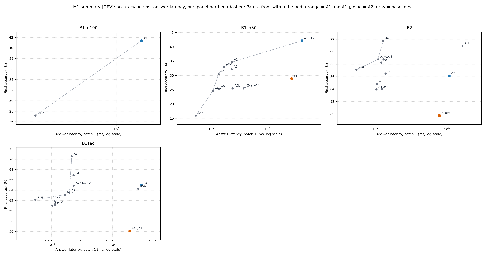

# M1 Efficiency Benchmark Report [DEV]

**Generated on**: `DEV` split evaluation records.
**Record schema**: `1.2.0`.

---

## Executive Summary

M1 measures the accuracy and computational cost of **Baseline v1** and its baselines across multiple benchmark beds using a unified cost meter (`costlab`). Every method is tuned on development seeds only, and evaluated under pinned thread affinity (logical CPUs 0 and 2, 2 threads).

### Summary Figure

### Key Milestone Decisions & Predictions

| Item | Description | Status | Details / Numbers |
|:---|:---|:---:|:---|
| **M1-1** | On B1 with N = 100, batch 1, CPU: the pool's median latency per input is at least that of the best-tuned replay network (no wall-clock gain) while its counted multiply-adds are at most a quarter of the replay network's. | `PASS` | pool_latency_s=0.0017, replay_latency_s=0.0002, latency_ratio=10.1319 |
| **M1-2** | On B1 with N = 100, the pool-to-replay latency ratio at batch 32 is lower than at batch 1. | `FAIL` | ratio_batch_1=10.1319, ratio_batch_32=36.7756, a1_latency_b1=0.0000 |
| **M1-3** | Whole-stream training wall-clock of the pool is at most half that of the best same-memory replay arm on B1 with N = 30 and N = 100. | `PASS` | ratio_n30=0.2051, ratio_n100=0.4177, pool_wall_n30=9.4156 |
| **M1-4** | Gate, router and bookkeeping take more than 60 % of the pool's observe wall-clock on B2 and B3. | `PASS` | share_b2=0.8203, share_b3=0.8330, a1_share_b2=0.5743 |
| **M1-5** | On B2 the better of kNN and streaming LDA reaches at least the pool's final accuracy. | `PASS` | pool_arm=A2, pool_acc=0.8611, baseline_acc={'A7-2': 0.8877777804931005, 'A7': 0.8877777804931005, 'A7all': 0.8877777804931005, 'A5a': 0.8711111098527908} |
| **M1-6** | On B3, streaming LDA is within 0.02 of the LDA-head pool in at least two of the three schedules. | `FAIL` | B3seq={'acc_lda': 0.6213506277311932, 'acc_pool': 0.6531661362810568, 'diff': 0.03181550854986359, 'within_02': False}, B3mix={'acc_lda': 0.6197437745603649, 'acc_pool': 0.6547430293126539, 'diff': 0.034999254752289044, 'within_02': False}, B3drift={'acc_lda': 0.6162991354411298, 'acc_pool': 0.6384436996145681, 'diff': 0.022144564173438352, 'within_02': False} |
| **M1-7** | Decision rule 6.1 fires on B2 and B3 and does not fire on B1. | `PASS` | b1_fired=False, b2_fired=True, b3_fired=True |
| **M1-8** | Pool memory grows linearly with the number of regimes on B1, the slope within 25 % of one expert's bytes. | `PASS` | r_squared=0.9930, slope=359015.2387, bytes_per_expert=352535.2000 |
| **M1-9** | By rules 6.2: the LDA head is adopted, growth_rule gap is adopted, skip_known is not, transfer_chance is not. | `FAIL` | lda_adopted=True, growth_adopted=False, skip_adopted=False |

---

## 1. Scoreboards [DEV]

### Bed: B1_n100 [DEV]

| Arm | Accuracy (mean+/-std [95% CI]) | Forgetting | Update Wall (s) | Update MACs | Ans Lat B1 (ms) | Ans MACs | Memory (B) | Experts | Operating Point |
|:---|:---|:---|:---:|:---:|:---:|:---:|:---:|:---:|:---|
| **A1*** | 23.91% | 11.26% | 0.00 +/- 0.00 | 3,041,473,129,984 | 0.00 +/- 0.00 | 4,621,312 | 55,492,608 | 256.0 | `inner_steps=20, q=0.05` |
| **A2*** | 41.35% | 0.15% | 62.44 +/- 0.00 | 721,990,272,000 | 1.73 +/- 0.00 | 112,128 | 35,384,720 | 100.0 | `inner_steps=5, q=0.02, candidate=shipped` |
| **A5a*** | 14.35% | 3.46% | 0.00 +/- 0.00 | 0 | 0.00 +/- 0.00 | 1,024 | 69,632 | 1.0 | `shrinkage=0.001` |
| **A5b*** | 21.59% | 3.93% | 0.00 +/- 0.00 | 0 | 0.00 +/- 0.00 | 131,072 | 528,384 | 1.0 | `shrinkage=0.5` |
| **A3-2** | 27.20% | 8.28% | 149.48 +/- 0.00 | 10,273,652,736,000 | 0.17 +/- 0.00 | 1,049,600 | 35,384,352 | 1.0 | `inner_steps=20, hidden=4096` |

*Arms marked with `*` carry uncounted_note (non-matrix-multiply operations).* 

### Bed: B1_n10 [DEV]

| Arm | Accuracy (mean+/-std [95% CI]) | Forgetting | Update Wall (s) | Update MACs | Ans Lat B1 (ms) | Ans MACs | Memory (B) | Experts | Operating Point |
|:---|:---|:---|:---:|:---:|:---:|:---:|:---:|:---:|:---|
| **A1*** | 30.23% [21.97%, 38.48%] | -0.04% [-1.15%, 1.07%] | 0.00 +/- 0.00 | 90,609,295,360 | 0.00 +/- 0.00 | 91,520 | 18,779,104 | 67.0 | `inner_steps=20, q=0.05` |
| **A1q*** | 44.21% [41.51%, 46.91%] | -0.31% [-3.33%, 2.71%] | 0.00 +/- 0.00 | 18,485,673,984 | 0.00 +/- 0.00 | 361,472 | 4,023,616 | 10.0 | `inner_steps=5, q=0.02` |
| **A2*** | 44.21% [41.51%, 46.91%] | -0.31% [-3.33%, 2.71%] | 0.00 +/- 0.00 | 18,485,673,984 | 0.00 +/- 0.00 | 361,472 | 4,023,616 | 10.0 | `inner_steps=5, q=0.02, candidate=shipped` |
| **A3** | 39.53% [39.21%, 39.84%] | 3.62% [-7.81%, 15.06%] | 0.00 +/- 0.00 | 2,409,041,756,160 | 0.00 +/- 0.00 | 2,098,176 | 13,343,264 | 1.0 | `inner_steps=20, hidden=8192` |
| **A4** | 31.39% [27.42%, 35.36%] | 1.49% [1.33%, 1.65%] | 0.00 +/- 0.00 | 90,471,333,888 | 0.00 +/- 0.00 | 525,312 | 7,027,232 | 1.0 | `inner_steps=3, hidden=2048` |
| **A5a*** | 19.69% [16.03%, 23.34%] | 6.99% [5.24%, 8.73%] | 0.00 +/- 0.00 | 0 | 0.00 +/- 0.00 | 1,024 | 69,632 | 1.0 | `shrinkage=0.001` |
| **A5b*** | 26.34% [23.96%, 28.72%] | 0.25% [-5.47%, 5.97%] | 0.00 +/- 0.00 | 0 | 0.00 +/- 0.00 | 131,072 | 528,384 | 1.0 | `shrinkage=0.5` |
| **A6*** | 29.49% [27.11%, 31.87%] | 4.96% [1.94%, 7.98%] | 0.00 +/- 0.00 | 654,940,569,600 | 0.00 +/- 0.00 | 1,114,112 | 268,697,600 | 1.0 | `D=8192, ridge=1.0` |
| **A7** | 26.27% [25.00%, 27.55%] | -0.37% [-1.01%, 0.26%] | 0.00 +/- 0.00 | 0 | 0.00 +/- 0.00 | 1,228,800 | 4,915,200 | 1.0 | `k=15` |
| **A7all** | 26.27% [25.00%, 27.55%] | -0.37% [-1.01%, 0.26%] | 0.00 +/- 0.00 | 0 | 0.00 +/- 0.00 | 1,228,800 | 4,915,200 | 1.0 | `k=15` |
| **A8** | 35.88% [33.65%, 38.10%] | 4.33% [2.74%, 5.91%] | 0.00 +/- 0.00 | 5,027,565,404,160 | 0.00 +/- 0.00 | 2,098,176 | 13,343,264 | 1.0 | `inner_steps=20, hidden=8192` |
| **A3-2** | 19.75% [8.95%, 30.55%] | 19.79% [3.11%, 36.46%] | 0.00 +/- 0.00 | 1,205,108,736,000 | 0.00 +/- 0.00 | 1,049,600 | 4,225,568 | 1.0 | `inner_steps=20, hidden=4096` |
| **A4-2** | 24.35% [20.22%, 28.48%] | 2.60% [-3.75%, 8.95%] | 0.00 +/- 0.00 | 15,166,734,336 | 0.00 +/- 0.00 | 132,096 | 4,023,328 | 1.0 | `inner_steps=2, hidden=512` |
| **A7-2** | 26.10% [18.79%, 33.41%] | 0.60% [-5.44%, 6.64%] | 0.00 +/- 0.00 | 0 | 0.00 +/- 0.00 | 1,005,824 | 4,023,296 | 1.0 | `k=15` |
| **H_shipped+chance*** | 44.21% [41.51%, 46.91%] | -0.31% [-3.33%, 2.71%] | 0.00 +/- 0.00 | 18,485,673,984 | 0.00 +/- 0.00 | 361,472 | 4,023,616 | 10.0 | `inner_steps=5, q=0.02, candidate=shipped+chance` |
| **H_shipped+gap*** | 44.21% [41.51%, 46.91%] | -0.31% [-3.33%, 2.71%] | 0.00 +/- 0.00 | 18,710,593,536 | 0.00 +/- 0.00 | 361,472 | 4,023,616 | 10.0 | `inner_steps=5, q=0.02, candidate=shipped+gap` |
| **H_shipped+skip*** | 44.21% [41.51%, 46.91%] | -0.31% [-3.33%, 2.71%] | 0.00 +/- 0.00 | 18,485,673,984 | 0.00 +/- 0.00 | 361,472 | 4,023,616 | 10.0 | `inner_steps=5, q=0.02, candidate=shipped+skip` |
| **H_shipped*** | 44.21% [41.51%, 46.91%] | -0.31% [-3.33%, 2.71%] | 0.00 +/- 0.00 | 18,485,673,984 | 0.00 +/- 0.00 | 361,472 | 4,023,616 | 10.0 | `inner_steps=5, q=0.02, candidate=shipped` |

*Arms marked with `*` carry uncounted_note (non-matrix-multiply operations).* 

### Bed: B1_n30 [DEV]

| Arm | Accuracy (mean+/-std [95% CI]) | Forgetting | Update Wall (s) | Update MACs | Ans Lat B1 (ms) | Ans MACs | Memory (B) | Experts | Operating Point |
|:---|:---|:---|:---:|:---:|:---:|:---:|:---:|:---:|:---|
| **A1*** | 28.92% [28.76%, 29.08%] | 1.19% [-0.08%, 2.46%] | 67.74 +/- 0.00 | 522,142,847,232 | 2.78 +/- 0.00 | 124,672 | 55,329,856 | 198.0 | `inner_steps=20, q=0.05` |
| **A1q*** | 42.13% [41.39%, 42.87%] | -0.27% [-1.11%, 0.58%] | 9.39 +/- 0.00 | 81,528,422,400 | 4.28 +/- 0.00 | 1,016,832 | 12,070,336 | 30.0 | `inner_steps=5, q=0.02` |
| **A2*** | 42.13% [41.39%, 42.87%] | -0.27% [-1.11%, 0.58%] | 9.42 +/- 0.00 | 81,528,422,400 | 4.29 +/- 0.00 | 1,016,832 | 12,070,336 | 30.0 | `inner_steps=5, q=0.02, candidate=shipped` |
| **A3** | 34.64% [34.43%, 34.85%] | 5.69% [4.10%, 7.28%] | 102.72 +/- 0.00 | 6,437,539,676,160 | 0.23 +/- 0.00 | 2,098,176 | 21,535,264 | 1.0 | `inner_steps=20, hidden=8192` |
| **A4** | 30.49% [26.57%, 34.41%] | 6.33% [0.51%, 12.16%] | 8.44 +/- 0.00 | 483,522,379,776 | 0.13 +/- 0.00 | 525,312 | 15,219,232 | 1.0 | `inner_steps=6, hidden=2048` |
| **A5a*** | 15.99% [13.50%, 18.48%] | 5.21% [0.82%, 9.61%] | 1.13 +/- 0.00 | 0 | 0.05 +/- 0.00 | 1,024 | 69,632 | 1.0 | `shrinkage=0.001` |
| **A5b*** | 25.53% [22.09%, 28.97%] | 2.33% [1.11%, 3.55%] | 0.56 +/- 0.00 | 0 | 0.23 +/- 0.00 | 131,072 | 528,384 | 1.0 | `shrinkage=0.5` |
| **A6*** | 25.30% [23.77%, 26.84%] | 4.70% [3.43%, 5.97%] | 64.18 +/- 0.00 | 1,746,508,185,600 | 0.13 +/- 0.00 | 1,114,112 | 268,697,600 | 1.0 | `D=8192, ridge=1.0` |
| **A7** | 25.84% [23.94%, 27.75%] | 0.04% [-0.54%, 0.62%] | 0.19 +/- 0.00 | 0 | 0.40 +/- 0.00 | 3,276,800 | 13,107,200 | 1.0 | `k=15` |
| **A7all** | 25.84% [23.94%, 27.75%] | 0.04% [-0.54%, 0.62%] | 0.02 +/- 0.00 | 0 | 0.40 +/- 0.00 | 3,276,800 | 13,107,200 | 1.0 | `k=15` |
| **A8** | 32.20% [31.62%, 32.79%] | 4.20% [0.65%, 7.74%] | 283.13 +/- 0.00 | 13,406,841,077,760 | 0.23 +/- 0.00 | 2,098,176 | 21,535,264 | 1.0 | `inner_steps=20, hidden=8192` |
| **A3-2** | 32.97% [31.70%, 34.24%] | 6.40% [1.47%, 11.32%] | 45.91 +/- 0.00 | 3,220,340,736,000 | 0.16 +/- 0.00 | 1,049,600 | 12,069,920 | 1.0 | `inner_steps=20, hidden=4096` |
| **A4-2** | 24.62% [15.09%, 34.15%] | 5.08% [-3.97%, 14.13%] | 2.38 +/- 0.00 | 81,058,332,672 | 0.10 +/- 0.00 | 132,096 | 12,069,920 | 1.0 | `inner_steps=4, hidden=512` |
| **A7-2** | 25.50% [23.65%, 27.36%] | 0.86% [-0.25%, 1.97%] | 0.17 +/- 0.00 | 0 | 0.37 +/- 0.00 | 3,017,472 | 12,069,888 | 1.0 | `k=15` |
| **H_shipped+chance*** | 42.13% [41.39%, 42.87%] | -0.27% [-1.11%, 0.58%] | 9.45 +/- 0.00 | 81,528,422,400 | 4.24 +/- 0.00 | 1,016,832 | 12,070,336 | 30.0 | `inner_steps=5, q=0.02, candidate=shipped+chance` |
| **H_shipped+gap*** | 42.13% [41.39%, 42.87%] | -0.27% [-1.11%, 0.58%] | 9.50 +/- 0.00 | 82,077,745,152 | 4.26 +/- 0.00 | 1,016,832 | 12,070,336 | 30.0 | `inner_steps=5, q=0.02, candidate=shipped+gap` |
| **H_shipped+skip*** | 42.13% [41.39%, 42.87%] | -0.27% [-1.11%, 0.58%] | 9.42 +/- 0.00 | 81,528,422,400 | 4.28 +/- 0.00 | 1,016,832 | 12,070,336 | 30.0 | `inner_steps=5, q=0.02, candidate=shipped+skip` |
| **H_shipped*** | 42.13% [41.39%, 42.87%] | -0.27% [-1.11%, 0.58%] | 9.45 +/- 0.00 | 81,528,422,400 | 4.43 +/- 0.00 | 1,016,832 | 12,070,336 | 30.0 | `inner_steps=5, q=0.02, candidate=shipped` |

*Arms marked with `*` carry uncounted_note (non-matrix-multiply operations).* 

### Bed: B2 [DEV]

| Arm | Accuracy (mean+/-std [95% CI]) | Forgetting | Update Wall (s) | Update MACs | Ans Lat B1 (ms) | Ans MACs | Memory (B) | Experts | Operating Point |
|:---|:---|:---|:---:|:---:|:---:|:---:|:---:|:---:|:---|
| **A1*** | 79.72% [70.55%, 88.90%] | 5.39% [-0.96%, 11.74%] | 4.44 +/- 0.00 | 40,133,626,688 | 0.79 +/- 0.00 | 299,136 | 2,632,262 | 5.5 | `inner_steps=50, q=0.05` |
| **A1q*** | 79.72% [70.55%, 88.90%] | 5.39% [-0.96%, 11.74%] | 3.43 +/- 0.00 | 40,133,626,688 | 0.78 +/- 0.00 | 299,136 | 2,632,262 | 5.5 | `inner_steps=50, q=0.05` |
| **A2*** | 86.11% [81.88%, 90.35%] | 1.39% [-0.73%, 3.51%] | 5.43 +/- 0.00 | 37,354,436,288 | 1.08 +/- 0.00 | 239,232 | 3,365,866 | 6.0 | `inner_steps=50, q=0.05, candidate=U-real+chance-weak` |
| **A3** | 84.00% [74.12%, 93.88%] | 4.67% [-8.04%, 17.37%] | 2.01 +/- 0.00 | 96,875,520,000 | 0.12 +/- 0.00 | 272,000 | 2,110,772 | 1.0 | `inner_steps=20, hidden=1024` |
| **A4** | 84.78% [83.37%, 86.19%] | 3.33% [1.92%, 4.75%] | 1.75 +/- 0.00 | 39,606,131,712 | 0.10 +/- 0.00 | 75,392 | 1,716,020 | 1.0 | `inner_steps=29, hidden=256` |
| **A5a*** | 87.11% [78.64%, 95.58%] | 2.39% [0.27%, 4.51%] | 0.13 +/- 0.00 | 0 | 0.05 +/- 0.00 | 9,856 | 104,960 | 1.0 | `shrinkage=0.001` |
| **A5b*** | 90.94% [74.71%, 107.18%] | 0.11% [-4.12%, 4.35%] | 0.07 +/- 0.00 | 0 | 1.66 +/- 0.00 | 1,261,568 | 5,085,696 | 1.0 | `shrinkage=0.5` |
| **A6*** | 91.78% [90.37%, 93.19%] | 0.44% [-2.38%, 3.27%] | 1.67 +/- 0.00 | 52,850,688,000 | 0.13 +/- 0.00 | 839,680 | 68,370,432 | 1.0 | `D=4096, ridge=0.1` |
| **A7** | 88.78% [81.72%, 95.84%] | 0.06% [-2.06%, 2.17%] | 0.02 +/- 0.00 | 0 | 0.11 +/- 0.00 | 384,000 | 1,536,000 | 1.0 | `k=1` |
| **A7all** | 88.78% [81.72%, 95.84%] | 0.06% [-2.06%, 2.17%] | 0.00 +/- 0.00 | 0 | 0.11 +/- 0.00 | 384,000 | 1,536,000 | 1.0 | `k=1` |
| **A8** | 88.28% [84.75%, 91.81%] | 1.67% [-5.39%, 8.73%] | 6.36 +/- 0.00 | 225,607,680,000 | 0.12 +/- 0.00 | 272,000 | 2,630,964 | 1.0 | `inner_steps=20, hidden=1024` |
| **A3-2** | 86.50% [81.56%, 91.44%] | 3.00% [-15.35%, 21.35%] | 3.24 +/- 0.00 | 190,240,727,040 | 0.14 +/- 0.00 | 534,144 | 3,365,428 | 1.0 | `inner_steps=20, hidden=2048` |
| **A4-2** | 83.94% [73.36%, 94.53%] | 4.94% [0.00%, 9.89%] | 1.63 +/- 0.00 | 36,920,970,240 | 0.10 +/- 0.00 | 75,392 | 1,841,460 | 1.0 | `inner_steps=27, hidden=256` |
| **A7-2** | 88.78% [81.72%, 95.84%] | 0.06% [-2.06%, 2.17%] | 0.02 +/- 0.00 | 0 | 0.13 +/- 0.00 | 384,000 | 1,536,000 | 1.0 | `k=1` |
| **H_shipped+chance*** | 79.72% [70.55%, 88.90%] | 5.39% [-0.96%, 11.74%] | 3.40 +/- 0.00 | 40,133,626,688 | 0.78 +/- 0.00 | 299,136 | 2,632,262 | 5.5 | `inner_steps=50, q=0.05, candidate=shipped+chance` |
| **H_shipped+gap*** | 79.72% [70.55%, 88.90%] | 5.39% [-0.96%, 11.74%] | 3.41 +/- 0.00 | 40,222,881,344 | 0.77 +/- 0.00 | 299,136 | 2,632,262 | 5.5 | `inner_steps=50, q=0.05, candidate=shipped+gap` |
| **H_shipped+skip*** | 78.22% [66.93%, 89.52%] | 7.44% [-8.09%, 22.97%] | 3.04 +/- 0.00 | 36,668,295,488 | 0.79 +/- 0.00 | 299,136 | 2,632,264 | 5.5 | `inner_steps=50, q=0.05, candidate=shipped+skip` |
| **H_shipped*** | 79.72% [70.55%, 88.90%] | 5.39% [-0.96%, 11.74%] | 3.42 +/- 0.00 | 40,133,626,688 | 0.79 +/- 0.00 | 299,136 | 2,632,262 | 5.5 | `inner_steps=50, q=0.05, candidate=shipped` |

*Arms marked with `*` carry uncounted_note (non-matrix-multiply operations).* 

### Bed: B3drift [DEV]

| Arm | Accuracy (mean+/-std [95% CI]) | Forgetting | Update Wall (s) | Update MACs | Ans Lat B1 (ms) | Ans MACs | Memory (B) | Experts | Operating Point |
|:---|:---|:---|:---:|:---:|:---:|:---:|:---:|:---:|:---|
| **A1*** | 47.75% [43.00%, 52.50%] | 15.12% [15.01%, 15.23%] | 0.00 +/- 0.00 | 208,360,068,096 | 0.00 +/- 0.00 | 81,536 | 462,836 | 1.0 | `inner_steps=50, q=0.05` |
| **A1q*** | 47.75% [43.00%, 52.50%] | 15.12% [15.01%, 15.23%] | 0.00 +/- 0.00 | 208,360,068,096 | 0.00 +/- 0.00 | 81,536 | 462,836 | 1.0 | `inner_steps=50, q=0.05` |
| **A2*** | 63.84% [55.48%, 72.21%] | 6.21% [-1.05%, 13.46%] | 0.00 +/- 0.00 | 151,220,161,280 | 0.00 +/- 0.00 | 97,536 | 1,179,628 | 1.0 | `inner_steps=50, q=0.02, candidate=ULDA` |
| **A3** | 43.60% [36.30%, 50.91%] | 18.07% [10.39%, 25.76%] | 0.00 +/- 0.00 | 179,892,587,520 | 0.00 +/- 0.00 | 147,072 | 601,588 | 1.0 | `inner_steps=20, hidden=512` |
| **A4** | 43.18% [31.76%, 54.60%] | 19.32% [14.76%, 23.88%] | 0.00 +/- 0.00 | 204,128,769,024 | 0.00 +/- 0.00 | 278,144 | 1,127,924 | 1.0 | `inner_steps=12, hidden=1024` |
| **A5a*** | 61.63% [56.89%, 66.37%] | 3.03% [-7.94%, 14.01%] | 0.00 +/- 0.00 | 0 | 0.00 +/- 0.00 | 16,000 | 129,536 | 1.0 | `shrinkage=0.001` |
| **A5b*** | 66.47% [62.02%, 70.93%] | 1.41% [-1.94%, 4.76%] | 0.00 +/- 0.00 | 0 | 0.00 +/- 0.00 | 2,048,000 | 8,256,000 | 1.0 | `shrinkage=0.5` |
| **A6*** | 70.08% [63.35%, 76.81%] | 1.62% [0.37%, 2.86%] | 0.00 +/- 0.00 | 707,380,224,000 | 0.00 +/- 0.00 | 2,072,576 | 272,531,456 | 1.0 | `D=8192, ridge=1.0` |
| **A7** | 45.62% [36.72%, 54.52%] | 5.44% [-5.55%, 16.43%] | 0.00 +/- 0.00 | 0 | 0.00 +/- 0.00 | 115,584 | 462,336 | 1.0 | `k=5` |
| **A7all** | 64.78% [63.35%, 66.22%] | 1.21% [-1.44%, 3.85%] | 0.00 +/- 0.00 | 0 | 0.00 +/- 0.00 | 1,308,800 | 5,235,200 | 1.0 | `k=5` |
| **A8** | 67.58% [62.20%, 72.96%] | 2.26% [-1.52%, 6.03%] | 0.00 +/- 0.00 | 5,355,572,428,800 | 0.00 +/- 0.00 | 2,113,152 | 13,723,636 | 1.0 | `inner_steps=20, hidden=8192` |
| **A3-2** | 41.72% [26.58%, 56.85%] | 21.35% [10.64%, 32.07%] | 0.00 +/- 0.00 | 1,302,146,780,160 | 0.00 +/- 0.00 | 1,064,576 | 4,285,940 | 1.0 | `inner_steps=20, hidden=4096` |
| **A4-2** | 46.39% [-6.33%, 99.11%] | 18.22% [-23.14%, 59.58%] | 0.00 +/- 0.00 | 136,085,846,016 | 0.00 +/- 0.00 | 278,144 | 1,183,732 | 1.0 | `inner_steps=8, hidden=1024` |
| **A7-2** | 54.58% [52.56%, 56.61%] | 4.63% [3.69%, 5.57%] | 0.00 +/- 0.00 | 0 | 0.00 +/- 0.00 | 294,784 | 1,179,136 | 1.0 | `k=5` |
| **H_shipped+chance*** | 47.75% [43.00%, 52.50%] | 15.12% [15.01%, 15.23%] | 0.00 +/- 0.00 | 208,360,068,096 | 0.00 +/- 0.00 | 81,536 | 462,836 | 1.0 | `inner_steps=50, q=0.05, candidate=shipped+chance` |
| **H_shipped+gap*** | 47.75% [43.00%, 52.50%] | 15.12% [15.01%, 15.23%] | 0.00 +/- 0.00 | 151,620,180,480 | 0.00 +/- 0.00 | 81,536 | 462,836 | 1.0 | `inner_steps=50, q=0.05, candidate=shipped+gap` |
| **H_shipped+skip*** | 48.33% [45.69%, 50.97%] | 14.50% [6.52%, 22.48%] | 0.00 +/- 0.00 | 208,323,492,096 | 0.00 +/- 0.00 | 81,536 | 462,836 | 1.0 | `inner_steps=50, q=0.05, candidate=shipped+skip` |
| **H_shipped*** | 47.75% [43.00%, 52.50%] | 15.12% [15.01%, 15.23%] | 0.00 +/- 0.00 | 208,360,068,096 | 0.00 +/- 0.00 | 81,536 | 462,836 | 1.0 | `inner_steps=50, q=0.05, candidate=shipped` |
| **H_U-real*** | 47.29% [46.87%, 47.71%] | 15.34% [9.92%, 20.77%] | 0.00 +/- 0.00 | 151,053,683,456 | 0.00 +/- 0.00 | 81,536 | 1,049,588 | 1.0 | `inner_steps=50, q=0.05, candidate=U-real` |
| **H_ULDA*** | 63.84% [55.48%, 72.21%] | 6.21% [-1.05%, 13.46%] | 0.00 +/- 0.00 | 151,220,161,280 | 0.00 +/- 0.00 | 97,536 | 1,179,628 | 1.0 | `inner_steps=50, q=0.05, candidate=ULDA` |

*Arms marked with `*` carry uncounted_note (non-matrix-multiply operations).* 

### Bed: B3mix [DEV]

| Arm | Accuracy (mean+/-std [95% CI]) | Forgetting | Update Wall (s) | Update MACs | Ans Lat B1 (ms) | Ans MACs | Memory (B) | Experts | Operating Point |
|:---|:---|:---|:---:|:---:|:---:|:---:|:---:|:---:|:---|
| **A1*** | 52.17% [52.03%, 52.32%] | 1.95% [-5.55%, 9.45%] | 0.00 +/- 0.00 | 208,486,053,888 | 0.00 +/- 0.00 | 81,536 | 462,836 | 1.0 | `inner_steps=50, q=0.05` |
| **A1q*** | 52.17% [52.03%, 52.32%] | 1.95% [-5.55%, 9.45%] | 0.00 +/- 0.00 | 208,486,053,888 | 0.00 +/- 0.00 | 81,536 | 462,836 | 1.0 | `inner_steps=50, q=0.05` |
| **A2*** | 65.47% [62.06%, 68.89%] | 0.71% [-4.06%, 5.48%] | 0.00 +/- 0.00 | 152,248,332,800 | 0.00 +/- 0.00 | 97,536 | 917,484 | 1.0 | `inner_steps=50, q=0.02, candidate=ULDA` |
| **A3** | 52.80% [41.25%, 64.35%] | 0.25% [-3.74%, 4.25%] | 0.00 +/- 0.00 | 179,980,830,720 | 0.00 +/- 0.00 | 147,072 | 601,588 | 1.0 | `inner_steps=20, hidden=512` |
| **A4** | 55.51% [47.07%, 63.95%] | 0.34% [-4.85%, 5.53%] | 0.00 +/- 0.00 | 204,228,900,864 | 0.00 +/- 0.00 | 278,144 | 1,127,924 | 1.0 | `inner_steps=12, hidden=1024` |
| **A5a*** | 61.97% [56.01%, 67.94%] | 0.19% [-1.65%, 2.02%] | 0.00 +/- 0.00 | 0 | 0.00 +/- 0.00 | 16,000 | 129,536 | 1.0 | `shrinkage=0.001` |
| **A5b*** | 64.74% [56.33%, 73.14%] | 0.46% [-3.81%, 4.72%] | 0.00 +/- 0.00 | 0 | 0.00 +/- 0.00 | 2,048,000 | 8,256,000 | 1.0 | `shrinkage=0.5` |
| **A6*** | 70.28% [66.97%, 73.60%] | -0.62% [-2.50%, 1.26%] | 0.00 +/- 0.00 | 707,726,131,200 | 0.00 +/- 0.00 | 2,072,576 | 272,531,456 | 1.0 | `D=8192, ridge=1.0` |
| **A7** | 43.90% [41.44%, 46.36%] | 3.79% [-0.42%, 8.00%] | 0.00 +/- 0.00 | 0 | 0.00 +/- 0.00 | 115,584 | 462,336 | 1.0 | `k=5` |
| **A7all** | 64.39% [64.26%, 64.51%] | -0.96% [-1.45%, -0.48%] | 0.00 +/- 0.00 | 0 | 0.00 +/- 0.00 | 1,309,440 | 5,237,760 | 1.0 | `k=5` |
| **A8** | 68.22% [64.02%, 72.41%] | -0.08% [-3.26%, 3.09%] | 0.00 +/- 0.00 | 5,274,427,392,000 | 0.00 +/- 0.00 | 2,113,152 | 13,726,196 | 1.0 | `inner_steps=20, hidden=8192` |
| **A3-2** | 53.41% [33.50%, 73.31%] | 0.83% [-0.81%, 2.47%] | 0.00 +/- 0.00 | 1,302,785,525,760 | 0.00 +/- 0.00 | 1,064,576 | 4,285,940 | 1.0 | `inner_steps=20, hidden=4096` |
| **A4-2** | 56.44% [52.28%, 60.60%] | 0.24% [-0.51%, 0.99%] | 0.00 +/- 0.00 | 136,152,600,576 | 0.00 +/- 0.00 | 278,144 | 1,127,924 | 1.0 | `inner_steps=8, hidden=1024` |
| **A7-2** | 51.49% [20.51%, 82.47%] | 2.33% [-10.34%, 14.99%] | 0.00 +/- 0.00 | 0 | 0.00 +/- 0.00 | 229,248 | 916,992 | 1.0 | `k=5` |
| **H_shipped+chance*** | 52.17% [52.03%, 52.32%] | 1.95% [-5.55%, 9.45%] | 0.00 +/- 0.00 | 208,486,053,888 | 0.00 +/- 0.00 | 81,536 | 462,836 | 1.0 | `inner_steps=50, q=0.05, candidate=shipped+chance` |
| **H_shipped+gap*** | 52.17% [52.03%, 52.32%] | 1.95% [-5.55%, 9.45%] | 0.00 +/- 0.00 | 151,746,556,416 | 0.00 +/- 0.00 | 81,536 | 462,836 | 1.0 | `inner_steps=50, q=0.05, candidate=shipped+gap` |
| **H_shipped+skip*** | 52.17% [52.03%, 52.32%] | 1.95% [-5.55%, 9.45%] | 0.00 +/- 0.00 | 208,486,053,888 | 0.00 +/- 0.00 | 81,536 | 462,836 | 1.0 | `inner_steps=50, q=0.05, candidate=shipped+skip` |
| **H_shipped*** | 52.17% [52.03%, 52.32%] | 1.95% [-5.55%, 9.45%] | 0.00 +/- 0.00 | 208,486,053,888 | 0.00 +/- 0.00 | 81,536 | 462,836 | 1.0 | `inner_steps=50, q=0.05, candidate=shipped` |
| **H_U-real*** | 52.17% [52.03%, 52.32%] | 1.95% [-5.55%, 9.45%] | 0.00 +/- 0.00 | 152,080,724,480 | 0.00 +/- 0.00 | 81,536 | 787,444 | 1.0 | `inner_steps=50, q=0.05, candidate=U-real` |
| **H_ULDA*** | 65.47% [62.06%, 68.89%] | 0.71% [-4.06%, 5.48%] | 0.00 +/- 0.00 | 152,248,332,800 | 0.00 +/- 0.00 | 97,536 | 917,484 | 1.0 | `inner_steps=50, q=0.05, candidate=ULDA` |

*Arms marked with `*` carry uncounted_note (non-matrix-multiply operations).* 

### Bed: B3seq [DEV]

| Arm | Accuracy (mean+/-std [95% CI]) | Forgetting | Update Wall (s) | Update MACs | Ans Lat B1 (ms) | Ans MACs | Memory (B) | Experts | Operating Point |
|:---|:---|:---|:---:|:---:|:---:|:---:|:---:|:---:|:---|
| **A1*** | 56.07% [48.40%, 63.74%] | 12.20% [5.35%, 19.05%] | 16.46 +/- 0.00 | 195,103,768,256 | 1.92 +/- 0.00 | 372,032 | 5,078,768 | 12.5 | `inner_steps=50, q=0.05` |
| **A1q*** | 56.07% [48.40%, 63.74%] | 12.20% [5.35%, 19.05%] | 13.94 +/- 0.00 | 195,103,768,256 | 1.91 +/- 0.00 | 372,032 | 5,078,768 | 12.5 | `inner_steps=50, q=0.05` |
| **A2*** | 64.95% [54.66%, 75.24%] | 5.43% [2.41%, 8.45%] | 25.04 +/- 0.00 | 192,574,316,352 | 2.95 +/- 0.00 | 686,720 | 14,185,078 | 19.0 | `inner_steps=50, q=0.02, candidate=ULDA` |
| **A3** | 60.99% [59.86%, 62.12%] | 9.98% [2.88%, 17.09%] | 6.21 +/- 0.00 | 224,102,430,720 | 0.10 +/- 0.00 | 147,072 | 5,078,516 | 1.0 | `inner_steps=20, hidden=512` |
| **A4** | 61.89% [24.53%, 99.24%] | 10.86% [-19.64%, 41.36%] | 3.92 +/- 0.00 | 190,721,115,648 | 0.11 +/- 0.00 | 278,144 | 5,078,516 | 1.0 | `inner_steps=9, hidden=1024` |
| **A5a*** | 62.14% [52.08%, 72.19%] | 5.76% [-5.50%, 17.02%] | 0.56 +/- 0.00 | 0 | 0.05 +/- 0.00 | 16,000 | 129,536 | 1.0 | `shrinkage=0.001` |
| **A5b*** | 64.27% [48.18%, 80.36%] | 2.88% [-5.61%, 11.37%] | 0.30 +/- 0.00 | 0 | 2.61 +/- 0.00 | 2,048,000 | 8,256,000 | 1.0 | `shrinkage=0.5` |
| **A6*** | 70.58% [64.99%, 76.16%] | 3.52% [3.03%, 4.00%] | 33.72 +/- 0.00 | 880,679,731,200 | 0.21 +/- 0.00 | 2,072,576 | 272,531,456 | 1.0 | `D=8192, ridge=1.0` |
| **A7** | 63.43% [60.37%, 66.48%] | 5.24% [-9.33%, 19.81%] | 0.09 +/- 0.00 | 0 | 0.20 +/- 0.00 | 1,269,632 | 5,078,528 | 1.0 | `k=5` |
| **A7all** | 64.88% [60.57%, 69.18%] | 3.64% [-7.39%, 14.68%] | 0.01 +/- 0.00 | 0 | 0.23 +/- 0.00 | 1,629,440 | 6,517,760 | 1.0 | `k=5` |
| **A8** | 66.88% [58.22%, 75.54%] | 6.33% [3.64%, 9.02%] | 152.30 +/- 0.00 | 7,124,534,231,040 | 0.23 +/- 0.00 | 2,113,152 | 15,006,196 | 1.0 | `inner_steps=20, hidden=8192` |
| **A3-2** | 63.11% [56.15%, 70.07%] | 9.49% [8.63%, 10.35%] | 24.99 +/- 0.00 | 1,622,158,325,760 | 0.17 +/- 0.00 | 1,064,576 | 10,795,508 | 1.0 | `inner_steps=20, hidden=4096` |
| **A4-2** | 61.12% [51.30%, 70.95%] | 11.46% [7.19%, 15.72%] | 3.96 +/- 0.00 | 190,721,115,648 | 0.11 +/- 0.00 | 278,144 | 7,637,492 | 1.0 | `inner_steps=9, hidden=1024` |
| **A7-2** | 64.88% [60.57%, 69.18%] | 3.64% [-7.39%, 14.68%] | 0.08 +/- 0.00 | 0 | 0.24 +/- 0.00 | 1,629,440 | 6,517,760 | 1.0 | `k=5` |
| **H_shipped+chance*** | 56.46% [38.87%, 74.04%] | 13.05% [8.01%, 18.10%] | 15.58 +/- 0.00 | 200,136,669,120 | 2.69 +/- 0.00 | 488,384 | 6,710,440 | 16.0 | `inner_steps=50, q=0.05, candidate=shipped+chance` |
| **H_shipped+gap*** | 56.07% [48.40%, 63.74%] | 12.20% [5.35%, 19.05%] | 13.95 +/- 0.00 | 195,600,909,248 | 1.91 +/- 0.00 | 372,032 | 5,078,768 | 12.5 | `inner_steps=50, q=0.05, candidate=shipped+gap` |
| **H_shipped+skip*** | 55.19% [53.35%, 57.03%] | 13.32% [0.64%, 26.01%] | 13.49 +/- 0.00 | 191,416,907,456 | 1.91 +/- 0.00 | 372,032 | 5,078,768 | 12.5 | `inner_steps=50, q=0.05, candidate=shipped+skip` |
| **H_shipped*** | 56.07% [48.40%, 63.74%] | 12.20% [5.35%, 19.05%] | 13.96 +/- 0.00 | 195,103,768,256 | 1.92 +/- 0.00 | 372,032 | 5,078,768 | 12.5 | `inner_steps=50, q=0.05, candidate=shipped` |
| **H_U-real*** | 63.69% [57.26%, 70.12%] | 5.44% [-0.78%, 11.66%] | 27.31 +/- 0.00 | 193,832,319,744 | 2.90 +/- 0.00 | 685,888 | 12,022,556 | 19.5 | `inner_steps=50, q=0.05, candidate=U-real` |
| **H_ULDA*** | 65.32% [61.49%, 69.14%] | 5.13% [4.43%, 5.84%] | 27.42 +/- 0.00 | 194,020,948,736 | 3.01 +/- 0.00 | 701,888 | 14,558,336 | 19.5 | `inner_steps=50, q=0.05, candidate=ULDA` |

*Arms marked with `*` carry uncounted_note (non-matrix-multiply operations).* 

---

## 2. Pre-registration Rule 6.1 Decisions [DEV]

Rule 6.1 triggers when an eligible baseline is within 1 point (0.01) of pool accuracy at lower update cost AND lower answer cost.

| Bed | Pool | Reading | Fired? | Triggering Baselines | Pool Accuracy | Baseline Accuracy & Latency |
|:---|:---:|:---:|:---:|:---|:---:|:---|
| B1_n10 | A1 | primary | NO | None | 30.23% | - |
| B1_n10 | A1 | secondary | NO | None | 30.23% | - |
| B1_n10 | A2 | primary | NO | None | 44.21% | - |
| B1_n10 | A2 | secondary | NO | None | 44.21% | - |
| B1_n100 | A1 | primary | NO | None | 23.91% | - |
| B1_n100 | A1 | secondary | NO | None | 23.91% | - |
| B1_n100 | A2 | primary | NO | None | 41.35% | - |
| B1_n100 | A2 | secondary | NO | None | 41.35% | - |
| B1_n30 | A1 | primary | **YES** | A4 | 28.92% | A4: 30.49% |
| B1_n30 | A1 | secondary | NO | None | 28.92% | - |
| B1_n30 | A2 | primary | NO | None | 42.13% | - |
| B1_n30 | A2 | secondary | NO | None | 42.13% | - |
| B2 | A1 | primary | **YES** | A3, A4, A5a, A6, A7, A7all | 79.72% | A3: 84.00%; A4: 84.78%; A5a: 87.11%; A6: 91.78%; A7: 88.78%; A7all: 88.78% |
| B2 | A1 | secondary | **YES** | A4, A5a | 79.72% | A4: 84.78%; A5a: 87.11% |
| B2 | A2 | primary | **YES** | A3-2, A5a, A6, A7-2, A7all | 86.11% | A3-2: 86.50%; A5a: 87.11%; A6: 91.78%; A7-2: 88.78%; A7all: 88.78% |
| B2 | A2 | secondary | **YES** | A5a | 86.11% | A5a: 87.11% |
| B3drift | A1 | primary | NO | None | 47.75% | - |
| B3drift | A1 | secondary | **YES** | A5a | 47.75% | A5a: 61.63% |
| B3drift | A2 | primary | NO | None | 63.84% | - |
| B3drift | A2 | secondary | NO | None | 63.84% | - |
| B3mix | A1 | primary | NO | None | 52.17% | - |
| B3mix | A1 | secondary | **YES** | A5a | 52.17% | A5a: 61.97% |
| B3mix | A2 | primary | NO | None | 65.47% | - |
| B3mix | A2 | secondary | NO | None | 65.47% | - |
| B3seq | A1 | primary | **YES** | A3, A4, A5a, A7, A7all | 56.07% | A3: 60.99%; A4: 61.89%; A5a: 62.14%; A7: 63.43%; A7all: 64.88% |
| B3seq | A1 | secondary | **YES** | A4, A5a | 56.07% | A4: 61.89%; A5a: 62.14% |
| B3seq | A2 | primary | **YES** | A5b, A7-2, A7all | 64.95% | A5b: 64.27%; A7-2: 64.88%; A7all: 64.88% |
| B3seq | A2 | secondary | NO | None | 64.95% | - |

---

## 3. Pre-registration Rule 6.2 Held Defaults Adoption [DEV]

| Held Default | Candidate vs Ref | Adopted? | Status | Decision Conditions & Supporting Evidence |
|:---|:---|:---:|:---:|:---|
| **lda_head** | ('U-real', 'ULDA') | `**ADOPT**` | `PASS` | gain_all=True, ci_two=True, worst_schedule_lat_rise=+3.84% (max +10%) |
| **growth** | ('shipped', 'shipped+gap') | `REJECT` | `FAIL` | acc_ok=True, wall_rel_change=+0.16% (<= -15%) |
| **skip** | ('shipped', 'shipped+skip') | `REJECT` | `FAIL` | acc_ok=False, obs_drop_b2_b3=True |
| **chance** | ('shipped', 'shipped+chance') | `REJECT` | `FAIL` | gain_one_bed=False, cost_ok_b2_b3=True |

---

## 4. Top Three Cost Drivers [DEV]

### Update Time Cost Drivers (from `pool_time_split`)

| Rank | Component | Duration (s) | Share of Update Time |
|:---:|:---|:---:|:---:|
| 1 | Router refit & prediction routing | 66.7896 s | 71.0% |
| 2 | Gate scan & candidate clustering | 21.0474 s | 22.4% |
| 3 | Expert weight updates (train_expert) | 6.2312 s | 6.6% |

### Answer Multiply-Add Split of the Reference Pool A2 (from the `accounting` block of each cell)

| Bed | Cells | Gate scan MACs (static) | Expert MACs | Gate share (static) | Gate MACs measured per input | Counted MACs per answer (costlab) |
|:---|:---:|:---:|:---:|:---:|:---:|:---:|
| B1_n100 | 1 | 3,276,800 | 33,792 | 99.0% | 854,530 | 112,128 |
| B1_n30 | 1 | 983,040 | 33,792 | 96.7% | 538,250 | 1,016,832 |
| B2 | 1 | 196,608 | 42,624 | 82.2% | 145,532 | 239,232 |
| B3seq | 1 | 696,704 | 48,768 | 93.5% | 364,846 | 683,648 |

---

## 5. Costlab vs Accounting Reconciliation Table [DEV]

Accounting = `growmoe.accounting.pool_report` of the trained arm (recorded in the cell); costlab = multiply-adds counted while one input is answered. Active bytes are the parameter bytes one answer touches (costlab), a different quantity from the stored bytes of the accounting. Costlab figures are taken over the same cells as the accounting figures; a ratio above one means costlab counted more multiplies than the static model (for example a naive per-class covariance product), below one means a shortlist skipped part of the scan.

| Bed | Arm | Cells (with accounting) | Costlab MACs | Accounting MACs | Ratio | Accounting stored bytes | Costlab active bytes |
|:---|:---|:---:|:---:|:---:|:---:|:---:|:---:|
| B1_n100 | **A1** | 1 (0) | 4,621,312 | not recorded | not recorded | not recorded | 138,280 |
| B1_n100 | **A2** | 1 (1) | 112,128 | 3,310,592 | 0.034 | 35,384,720 | 138,280 |
| B1_n100 | **A5a** | 1 (0) | 1,024 | not recorded | not recorded | not recorded | 0 |
| B1_n100 | **A5b** | 1 (0) | 131,072 | not recorded | not recorded | not recorded | 0 |
| B1_n100 | **A3-2** | 1 (1) | 1,049,600 | 1,049,600 | 1.000 | 35,384,352 | 4,217,384 |
| B2 | **A1** | 2 (1) | 153,984 | 153,984 | 1.000 | 1,590,840 | 173,953 |
| B2 | **A1q** | 2 (1) | 153,984 | 153,984 | 1.000 | 1,590,840 | 173,953 |
| B2 | **A2** | 2 (1) | 239,232 | 239,232 | 1.000 | 3,362,076 | 173,953 |
| B2 | **A3** | 2 (1) | 272,000 | 272,000 | 1.000 | 1,590,580 | 1,095,041 |
| B2 | **A4** | 2 (1) | 75,392 | 75,392 | 1.000 | 1,590,580 | 305,537 |
| B2 | **A5a** | 2 (1) | 9,856 | 9,856 | 1.000 | 104,960 | 0 |
| B2 | **A5b** | 2 (1) | 1,261,568 | 9,856 | 128.000 | 5,085,696 | 0 |
| B2 | **A6** | 2 (1) | 839,680 | 0 | accounting counts 0 | 68,370,432 | 0 |
| B2 | **A7** | 2 (1) | 384,000 | 384,000 | 1.000 | 1,536,000 | 0 |
| B2 | **A7all** | 2 (1) | 384,000 | 384,000 | 1.000 | 1,536,000 | 0 |
| B2 | **A8** | 2 (1) | 272,000 | 272,000 | 1.000 | 2,630,964 | 1,095,041 |
| B2 | **A3-2** | 2 (1) | 534,144 | 534,144 | 1.000 | 3,361,588 | 2,147,713 |
| B2 | **A4-2** | 2 (1) | 75,392 | 75,392 | 1.000 | 1,841,460 | 305,537 |
| B2 | **A7-2** | 2 (1) | 384,000 | 384,000 | 1.000 | 1,536,000 | 0 |
| B2 | **H_shipped+chance** | 2 (1) | 153,984 | 153,984 | 1.000 | 1,590,840 | 173,953 |
| B2 | **H_shipped+gap** | 2 (1) | 153,984 | 153,984 | 1.000 | 1,590,840 | 173,953 |
| B2 | **H_shipped+skip** | 2 (1) | 153,984 | 153,984 | 1.000 | 1,590,844 | 173,953 |
| B2 | **H_shipped** | 2 (1) | 153,984 | 153,984 | 1.000 | 1,590,840 | 173,953 |
| B3seq | **A1** | 2 (1) | 372,224 | 372,224 | 1.000 | 5,178,504 | 198,769 |
| B3seq | **A1q** | 2 (1) | 372,224 | 372,224 | 1.000 | 5,178,504 | 198,769 |
| B3seq | **A2** | 2 (1) | 683,648 | 745,472 | 0.917 | 13,940,904 | 198,769 |
| B3seq | **A3** | 2 (1) | 147,072 | 147,072 | 1.000 | 5,178,356 | 593,521 |
| B3seq | **A4** | 2 (1) | 278,144 | 278,144 | 1.000 | 5,178,356 | 1,119,857 |
| B3seq | **A5a** | 2 (1) | 16,000 | 16,000 | 1.000 | 129,536 | 0 |
| B3seq | **A5b** | 2 (1) | 2,048,000 | 16,000 | 128.000 | 8,256,000 | 0 |
| B3seq | **A6** | 2 (1) | 2,072,576 | 0 | accounting counts 0 | 272,531,456 | 0 |
| B3seq | **A7** | 2 (1) | 1,294,592 | 1,294,592 | 1.000 | 5,178,368 | 0 |
| B3seq | **A7all** | 2 (1) | 1,626,112 | 1,626,112 | 1.000 | 6,504,448 | 0 |
| B3seq | **A8** | 2 (1) | 2,113,152 | 2,113,152 | 1.000 | 14,992,884 | 8,488,561 |
| B3seq | **A3-2** | 2 (1) | 1,064,576 | 1,064,576 | 1.000 | 10,782,196 | 4,277,873 |
| B3seq | **A4-2** | 2 (1) | 278,144 | 278,144 | 1.000 | 7,624,180 | 1,119,857 |
| B3seq | **A7-2** | 2 (1) | 1,626,112 | 1,626,112 | 1.000 | 6,504,448 | 0 |
| B3seq | **H_shipped+chance** | 2 (1) | 572,416 | 572,416 | 1.000 | 7,981,780 | 198,769 |
| B3seq | **H_shipped+gap** | 2 (1) | 372,224 | 372,224 | 1.000 | 5,178,504 | 198,769 |
| B3seq | **H_shipped+skip** | 2 (1) | 372,224 | 372,224 | 1.000 | 5,178,504 | 198,769 |
| B3seq | **H_shipped** | 2 (1) | 372,224 | 372,224 | 1.000 | 5,178,504 | 198,769 |
| B3seq | **H_U-real** | 2 (1) | 697,984 | 697,984 | 1.000 | 12,086,620 | 198,769 |
| B3seq | **H_ULDA** | 2 (1) | 713,984 | 779,904 | 0.915 | 14,687,420 | 198,769 |

---

## 6. Generated Figures [DEV]

- [fig_acc_vs_update_B1_n100.png](figures/fig_acc_vs_update_B1_n100.png)
- [fig_acc_vs_answer_B1_n100.png](figures/fig_acc_vs_answer_B1_n100.png)
- [fig_acc_vs_update_B1_n10.png](figures/fig_acc_vs_update_B1_n10.png)
- [fig_acc_vs_answer_B1_n10.png](figures/fig_acc_vs_answer_B1_n10.png)
- [fig_acc_vs_update_B1_n30.png](figures/fig_acc_vs_update_B1_n30.png)
- [fig_acc_vs_answer_B1_n30.png](figures/fig_acc_vs_answer_B1_n30.png)
- [fig_acc_vs_update_B2.png](figures/fig_acc_vs_update_B2.png)
- [fig_acc_vs_answer_B2.png](figures/fig_acc_vs_answer_B2.png)
- [fig_acc_vs_update_B3drift.png](figures/fig_acc_vs_update_B3drift.png)
- [fig_acc_vs_answer_B3drift.png](figures/fig_acc_vs_answer_B3drift.png)
- [fig_acc_vs_update_B3mix.png](figures/fig_acc_vs_update_B3mix.png)
- [fig_acc_vs_answer_B3mix.png](figures/fig_acc_vs_answer_B3mix.png)
- [fig_acc_vs_update_B3seq.png](figures/fig_acc_vs_update_B3seq.png)
- [fig_acc_vs_answer_B3seq.png](figures/fig_acc_vs_answer_B3seq.png)
- [summary_figure.png](figures/summary_figure.png)

