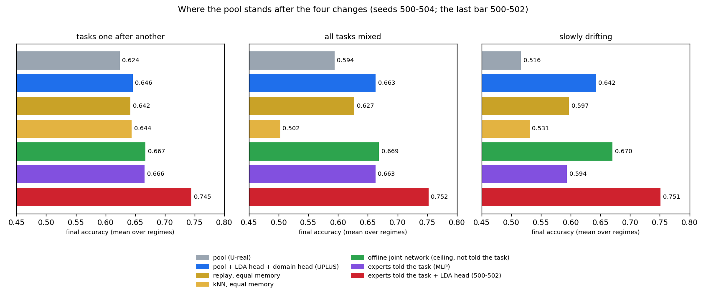

# UniMoE after the four changes: what each one did, what did not work, and where the system stands (2026-10-30)

You asked me to test, run, analyse and improve the four changes I had ranked at the end of Stage 1, and to report once done. This is that report. Everything here is computed from cached cells (`results/unimoe/p4_*`, tables in `results/unimoe/p4/TABLES.md`, `REFUSAL.md`, `REFUSAL_503_504.md`), every prediction was written down before the cells that test it (`research/unimoe/PROGRESS.md`), and the code has 77 passing tests (`tests/unimoe`).

## 1. The short version

| change | verdict | the number that matters |
|---|---|---|
| **4. Better expert fit** (a running LDA head inside every expert) | **Large, confirmed gain. The one that matters.** | pool accuracy +0.022 sequential, +0.069 mixed, +0.126 drifting over the Stage 1 pool (5 seeds, every interval excludes zero) |
| **1. Growth that does not depend on the training recipe** | **Works where capacity is the bottleneck; does not work on the real text suite, and I know why.** | arithmetic stream, start at 16 units: 0.725 -> 0.782 (a fixed 512-unit expert: 0.829 with 1.7x the parameters); real suite from 16 units: nothing fires sequentially, one event in the mixed and drifting schedules |
| **2. Supervised domain head** | **Small. Only helps where the pool mixes domains up.** | +0.001 sequential, +0.010 mixed, +0.032 drifting; nothing once the LDA head is in |
| **3. Refusal layer with calibration wired in** | **Partly works: turns a silent flag into a controlled one, but does not reach my bar.** | pool's built-in flag refuses 0.000 of foreign text; calibrated on 60 verified messages at 5 % false refusal the three readers together refuse 0.22-0.57 of three foreign text sets; the bar was 0.6 on each |

**The headline.** The Stage 1 pool trailed simple baselines. With the LDA head (and the domain head, which adds almost nothing) the pool now reaches the offline "joint" network, the ceiling for a system that is not told which task a message belongs to, in the mixed schedule (-0.006, interval includes zero) and in the drifting schedule (-0.028, includes zero), and is 0.021 below it sequentially. It beats the equal-memory replay network in the mixed schedule (+0.036) and ties it elsewhere, and beats the equal-memory kNN by 0.16 (mixed) and 0.11 (drifting). Sequentially it is level with replay and kNN (+0.004, +0.002). The last bar of the figure, experts that are *told* the task and carry LDA heads (0.745-0.752), is a ceiling that no system can reach without being told the task, because a short message can belong to several tasks.

## 2. Change 4: the LDA head (the big one)

**What it is.** LDA (linear discriminant analysis) fits one bell-shaped cloud per class, all with the same shape, in a single pass and in closed form: the expert keeps, per class, a running sum of the vectors it has seen and, for the whole expert, one running covariance. There is no gradient training, so it cannot forget what it has seen and costs a fixed amount of memory (about 32,500 numbers per expert for the 125 classes of this suite). The expert's answer is the blend, in log-probability, of its small neural network (the MLP) and its LDA head, with weight λ on the LDA head.

**Why I expected it to help.** In Stage 1 the experts, even when told the right task, scored 0.669, while an offline linear fit on the same task reaches 0.752. The experts, not the routing, were the weak part, and a closed-form fit is the thing the few gradient steps per batch only approach.

**First test, with routing taken out of the picture** (experts told the regime; seeds 500-502):

| λ (weight of the LDA head) | 0 (MLP only) | 0.3 | 0.5 | 0.7 | 1.0 (LDA only) |
|---|---|---|---|---|---|
| sequential | 0.669 | 0.714 | 0.731 | 0.745 | 0.750 |
| mixed | 0.663 | 0.737 | 0.750 | 0.752 | 0.748 |
| drifting | 0.604 | 0.706 | 0.737 | 0.751 | 0.749 |

The curve is flat from 0.7 to 1.0: the MLP adds nothing the LDA head does not already have on these features. (My prediction was +0.02 to +0.06 and 0.69-0.73 for the pure head: the true effect was larger, so both predictions missed on the high side.)

**In the pool** (λ tuned on seed 499 per schedule: 0.75 / 0.5 / 0.75; paired difference to the Stage 1 pool, 5 seeds 500-504):

| schedule | gain [95 % interval] | per seed |
|---|---|---|
| sequential | +0.022 [+0.010, +0.033] | 0.023, 0.024, 0.035, 0.012, 0.014 |
| mixed | +0.069 [+0.057, +0.082] | 0.070, 0.059, 0.081, 0.060, 0.077 |
| drifting | +0.126 [+0.100, +0.153] | 0.089, 0.139, 0.133, 0.138, 0.132 |

Every one of the 15 paired differences is positive. The two confirmation seeds (503-504), which no choice touched, reproduce the sign and size (+0.013 / +0.069 / +0.135).

**What it means.** The gain is large wherever the pool has few experts (mixed and drifting: one expert for all 22 regimes), because a single MLP trained by streaming gradient steps on 125 classes is a weak classifier and the LDA head is a good one. It is smaller sequentially (many small experts, each with an easy job). **Caveat I want you to keep in mind:** the LDA head wins because the features are a frozen sentence embedding where classes are roughly bell-shaped clouds. In Stage 2, where the representation is trained, this need not carry over; treat it as a result about frozen features, not about experts in general.

## 3. Change 1: growth that does not depend on the training recipe

**What it is.** The Stage 1 growth rule measured "how much of a fresh batch the expert can fit in its own training steps", a number that depends on how many steps the training recipe takes (0.09 / 0.59 / 0.98 at 1 / 5 / 20 steps) — so the tuned recipe silently switched growth off. The new statistic is the share of the batch's loss removed by **one** step on a copy of the expert: the same number whatever the recipe does. The maturity condition was also scaled to the stream (30 batches of age instead of 300).

**On a stream that needs capacity** (six arithmetic operators, 10,000 examples each; Stage 1's suite needed little capacity, so it could never have shown a benefit):

| | fixed 16 units | fixed 128 | fixed 512 | Stage 1 growth rule (fast maturity), from 16 | **new rule, from 16** | new rule at 5 steps |
|---|---|---|---|---|---|---|
| sequential | 0.725 | 0.806 | 0.829 | 0.725 (0 growth events) | **0.782** (7.7 events, 475 k params) | 0.779 (vs 0.736 fixed) |
| mixed | 0.678 | 0.753 | 0.768 | 0.678 (0 events) | **0.718** (5.7 events) | 0.769 (vs 0.707 fixed) |

Width really matters here (+0.104 from 16 to 512 units sequentially). The new rule fires without being told to, closes 55 % of the gap to a 512-unit expert with 59 % of its parameters, fires also when the recipe takes 5 steps instead of 20 (so it is recipe-independent as intended), and the old rule fires nothing, as diagnosed. The threshold θ was tuned on seed 499 only (0.02, 0.05: no growth; 0.1: 2 events; 0.2: 7 events and best; 0.4 the same).

**On the real text suite it does not work, and the reason is structural.** I started the real suite's experts at 16 units (a deliberately too-small start; they score 0.581 / 0.442 / 0.386 against 0.622 / 0.596 / 0.512 at the tuned 128 units) and let growth run:

| schedule | fixed 16 | grown from 16 | grow events | fixed 128 |
|---|---|---|---|---|
| sequential | 0.581 | 0.581 | 0, 1, 0 | 0.622 |
| mixed | 0.442 | 0.478 | 1, 1, 1 | 0.596 |
| drifting | 0.386 | 0.383 | 1, 1, 2 | 0.512 |

On the capacity stream's threshold (0.2) nothing fired in the sequential or mixed schedules. Going through the code showed why. **Growth fires when the fit gap is *below* θ** (the expert cannot fit a fresh batch quickly, so it needs width), so my first attempt to find a threshold for text — a grid *below* 0.2 — had the sign backwards and changed nothing (I recorded that as a mistake, F-63). The corrected grid (0.3 to 0.9) gives the same result at every value: **the threshold is not what limits growth.** What limits it is **experience**: in the sequential schedule an expert gets a **median of 5 batches** of training (smallest 4, largest 43), while the rule needs an expert to be at least 30 batches old and to compare two windows of at least 10 batches (a lower bound the configuration enforces and `growmoe/` may not be edited). In the mixed and drifting schedules there is one expert that sees everything, so growth fires once (twice in one drifting run), after which the maturity clock restarts and the stream is too short for a second event. So automatic *vertical* scaling is demonstrated where an expert lives long enough to be measured, and is impossible by construction where tasks are short, which is exactly the sequential real-text case.

**What would fix it** (not built): decide an expert's width once per *visit* of its regime, from how well it fits the regime it just finished, instead of from a moving window of batches. That is Q-41 in the notebook.

(One more admission: this experiment re-ran something Stage 1's E6 had already done — 16 units, fast maturity, mixed: 0.442 -> 0.478 with one event, the same numbers — and I predicted otherwise because I did not look that up first; F-64.)

**On the real suite with the tuned 128 units** the new rule fires nothing and the system is identical to the Stage 1 pool, cell for cell: it does no harm.

## 4. Change 2: the supervised domain head

**What it is.** A running LDA over the *class labels*, summed within each domain's block of labels, gives a probability for "which domain is this message from", trained for free from the labels, and the answer is restricted to (hard) or reweighted toward (soft) the predicted domain. My first design, an LDA over domain ids, was a poor model of a domain made of several clusters (domain accuracy 0.76); aggregating a class-level LDA fixed that.

**Result** (5 seeds, paired difference to the Stage 1 pool; hard / soft): sequential -0.001 / +0.001; mixed +0.010 / +0.011; drifting +0.032 / +0.032; wrong-domain rate 10.8 % -> 9.9 % (sequential), 9.6 % -> 7.0 % (mixed), 14.2 % -> 7.1 % (drifting). The soft power β made no difference at all (hard, β 0.5, 1 and 2 give the same final mean to three digits), which says the domain probability is saturated: the head is either sure or the message is genuinely ambiguous. With the LDA head already in, the domain head adds nothing (UPLUS = ULDA to ±0.001 everywhere).

**Why so little.** The domain confusion that is left is mostly the *task-ambiguity floor* (a short question that could be banking or news), which no head can remove because the label of such a message really is ambiguous; what the head removed was the part the pool added on top (14.2 % -> 7.1 % in drifting).

## 5. Change 3: the refusal layer

**What it is.** The pool's built-in "I don't know" flag is silent (it flagged 0 of 12,519 known messages and 0 of all three foreign sets: stories, encyclopedia sentences, school science questions). The layer gives each message a novelty score from up to three readers and sets each reader's cut from a sample of **60 verified known messages** (the false-refusal rate is then known by construction, 5 % at q = 0.05): the **pool** (1 minus its conformal p-value), the **asking reader** (a language model shown the message and six cards, one per domain, answering "which, or none") and, added in a second round, a **density reader** (the Mahalanobis distance to the nearest taught class, from the same running statistics as the LDA head).

**Result** (sequential schedule; calibration 60 verified messages, mean over 5 draws; refused share of each foreign set; seeds 500-502, confirmation 503-504 in the second line):

| reader | false refusal | science questions | stories | wiki |
|---|---|---|---|---|
| pool's built-in flag | 0.000 | 0.00 | 0.00 | 0.00 |
| asking reader, uncalibrated (its own "none") | 0.328 | 0.94 | 0.86 | 0.85 |
| pool, calibrated | 0.056 (conf. 0.064) | 0.46 (0.54) | 0.21 (0.32) | 0.37 (0.42) |
| asking reader, calibrated | 0.053 (0.055) | 0.17 (0.12) | 0.29 (0.24) | 0.13 (0.09) |
| either of those two | 0.073 (0.073) | 0.45 (0.46) | 0.33 (0.32) | 0.34 (0.34) |
| density reader, calibrated | 0.036 (0.052) | 0.50 (0.61) | 0.07 (0.16) | 0.39 (0.50) |
| **all three, either** | **0.052 (0.061)** | **0.45 (0.57)** | **0.22 (0.23)** | **0.32 (0.40)** |

Calibration works as designed: from a flag that refuses nothing, the pool's own score refuses 0.2-0.5 of foreign text at about 6 % false refusal, and answering only the accepted messages is more accurate (+0.011 to +0.021). Threshold-free quality, the AUROC (the chance a foreign message scores as more novel than a known one): density 0.93 / 0.81 / 0.89, pool 0.85 / 0.79 / 0.83, asking reader 0.83 / 0.84 / 0.79.

**It does not reach my bar** (0.6 of every foreign set at 5 % false refusal). Two reasons, both measured. First, with scores of AUROC about 0.85 a 5 % false-refusal cut can only catch a third to a half; reaching 0.6 needs AUROC near 0.95, and the limit is the representation (a 128-d random projection of a sentence embedding), not the calibration. Second, adding readers does not add recall at a fixed false-refusal rate, because the fused cut is set to the same *total* level (adding the density reader to the other two *lowered* the stories share from 0.33 to 0.22). At a looser level (q = 0.10, false refusal 0.11) the three together refuse 0.71 / 0.42 / 0.53. The uncalibrated language-model reader catches 0.85-0.94 but also refuses a third of known messages: a choice between a user who is annoyed and a system that answers foreign text, which only a deployment can make.

## 6. How much of this should you trust

* **Seeds.** 499 tunes (the growth threshold on the capacity stream; per schedule, the domain power β and the LDA weight λ); 500-502 evaluate; 503-504 confirm the final combined system and were touched by no choice. All five are development seeds; the reserved seeds (600-604, 400-429) are unspent, and nothing here is a pre-registered confirmatory result.
* **Tuning edges.** λ reached the top of its grid (0.75) in two schedules; the oracle curve shows 0.7-1.0 is a plateau, so this is the operating point and not a missed peak. β never mattered (ties; the first value won).
* **Predictions.** I declared 38 numeric predictions for the four changes and their follow-ups: **17 held, 21 missed (45 %)**; Stage 1's rate was 31 of 63 (49 %). The misses cluster in three places: I underestimated the LDA head (it beat my range in both oracle checks), overestimated the domain head (3 of its 5 predictions missed), and transferred a threshold from a stream where it worked to one where the mechanism is structurally blocked. Full list in `research/unimoe/PROGRESS.md` and notebook F-65.
* **Mistakes found and fixed on the way** (notebook F-62 to F-64). (1) An earlier mutation test had left a one-line edit in `unimoe/runner.py` (the per-phase "known messages flagged unknown" rate hard-coded to 0.0); the runner's own test catches it and I found it by diffing the stamped files against git. I restored the file and recomputed the published value from the stored test arrays: it is 0.0 for every system at the end of the sequential stream, so **no published number changed**; only the per-phase maximum of that rate is unverified (nothing cites it). (2) The sign error of the first small-start grid, above. (3) The repeat of E6.
* **Repository check.** The `truthgate` best-of-seeds warning on `unimoe/p4.py` is again a false positive: the loops run and print every seed; the only selection of a maximum is over thresholds on the single tuning seed, and that is documented.
* **Scope.** The refusal evaluation covers the six text domains (the arithmetic regimes are digit codes, not messages), uses 60 verified messages drawn from the same test sets as the evaluation messages (disjoint, 5 draws), and is sequential only.

## 7. What I would do next, in order

1. **Adopt the LDA head as the default of the next system** (the standing rule: confirmed repairs go in as defaults, the old entry point stays pinned). I did not change the code now because the stamped files key hundreds of cached cells; the recommended configuration is `ULDA` with λ 0.5-0.75, the domain head optional. Recorded as a decision (D-43).
2. **Per-visit right-sizing of experts** (Q-41), the missing piece of automatic vertical scaling on short tasks.
3. **A better representation for refusal** (Q-42): the full 384-d embedding or a representation trained for novelty; the calibration machinery is already in place and the AUROC is the number to move (0.85 -> 0.95).
4. **Stage 2** (token-level language-model MoE) is untouched; Q-43 asks whether the LDA head's dominance survives a trained representation.
5. The reserved confirmatory seeds should be spent only once, on a frozen system, after a pre-registration.

## Where everything is

* Code: `unimoe/heads.py`, `pools.py`, `density.py`, `capacity.py`, `refusal.py`, `systems2.py`, drivers `p4.py`, `p4_refusal.py`, `p4_report.py`; tests `tests/unimoe/test_um_pools.py`, `test_um_p4.py` (77 in the package, the pool tests mutation-checked).
* Data: `results/unimoe/p4_capacity*`, `p4_main`, `p4_main_small*`, `p4_oracle_lda`, `p4_refusal` (the readers' scores), `p4_tuning.json`; tables `p4/TABLES.md`, `p4/REFUSAL.md`, `p4/REFUSAL_503_504.md`, `p4/ladder.json`, figure `p4/figure_ladder.png`.
* Record: `research/unimoe/PROGRESS.md` (every prediction before its cells), notebook E-054, failures F-62..F-65, claims C-121..C-125, open questions Q-41..Q-44, decision D-43.
